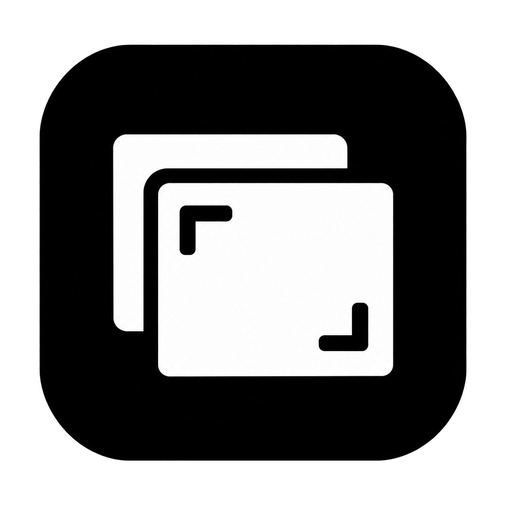
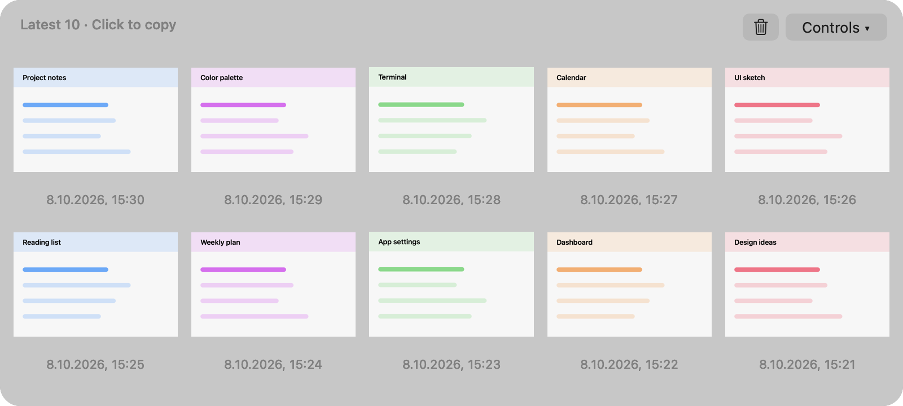
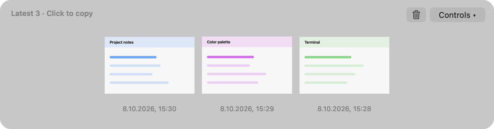

<p align="center"></p>
<h1 align="center">Recent Screenshots</h1>
<p align="center">Your last ten screenshots, one hover away.</p>
<p align="center">
  
  
  
</p>

I use a Logitech mouse button to select part of my screen and copy it straight to the clipboard. I wanted those screenshots within reach without saving each one manually or opening a big clipboard manager.

Inspired by [Tendedero](https://github.com/alejandrobujan/tendedero), I built this small native macOS app with **OpenAI Codex**. Yes, it was vibe-coded: I described what I wanted, tried it, and iterated with Codex. It is a personal tool, shared as-is.

## A small shelf for your screenshots



Hover near the top of either screen for a moment. The shelf opens near that point and stays put. Click an image to copy it; right-click to open it or show it in Finder. Move away or click outside to dismiss.

- Keeps the **latest 10 images** in two rows of five.
- Uses **one-row height** when there are five or fewer images.
- Picks up **clipboard screenshots**, including the Logitech workflow above.
- Can also watch the folder where macOS saves screenshots.
- Uses a centered **75% hover zone** by default; choose 25%, 50%, 75%, or 100% in Controls.
- Includes a trash button to clear history and an optional **Open at login** setting.



*These are renders of the real native shelf using synthetic sample images. They contain no private screenshots or clipboard data.*

## Install

Download the `.pkg` installer from [Releases](https://github.com/berkegokmen1/macos-recent-screenshots/releases).

1. Run the installer. It installs or updates **Recent Screenshots.app** in **Applications** and closes your running copy.
2. Open **Applications → Recent Screenshots**. It lives in the menu bar, not the Dock.
3. Take a screenshot to the clipboard, then hover at the top edge to see it.

For automatic startup, enable **Controls → Open at login** after installing. macOS may ask you to approve it in Login Items settings.

**Requirements:** macOS 14 or later. The current installer is built for Apple silicon. The source can be built on an Intel Mac, but that configuration has not been tested. Runtime testing so far has been on macOS 26.6.2.

**Signing:** this is a development build. The app is ad hoc signed; the installer is unsigned, and neither is Apple-notarized. macOS may block a downloaded build. Building from source is an alternative. Do not disable Gatekeeper or remove quarantine just because a README or issue tells you to.

## What it reads and stores

Clipboard-image capture is **enabled by default**. The app checks for changes every half-second, reads PNG/TIFF image data, and stores a local copy. It also imports an image already on your clipboard at launch.

It ignores text, Finder file icons, and clipboard items marked concealed, transient, or autogenerated. Those markers are best-effort filters, not a guarantee that sensitive images cannot enter history. Any copied image may appear here, including one copied from a browser; the app cannot identify whether it came from your screenshot button.

The app makes **no network requests**, has no account or analytics, and does not change macOS screenshot settings. It may ask for Desktop or another folder's permission if that is where your screenshot files live.

Clipboard copies are stored in:

```text
~/Library/Application Support/RecentScreenshots/Clipboard
```

Only the latest 10 clipboard copies are retained; older app-created copies are automatically removed. The limit is by image count, not disk size. Files are ordinary local PNGs, not an encrypted vault.

The trash button moves the app's clipboard copies to Trash and clears the shelf. Original screenshot files in your chosen folder stay untouched and are hidden from the shelf until new captures arrive. Clearing does not erase your current system clipboard. Turn off **Keep copied images** in Controls to stop capture.

The shelf displays screenshot previews on your screen, so turn off hover reveal while presenting or sharing your screen if necessary.

## Build it yourself

Requires Apple's Command Line Tools and their Swift compiler. Installer packaging also requires Python 3.

```sh
git clone https://github.com/berkegokmen1/macos-recent-screenshots.git
cd macos-recent-screenshots
bash scripts/build.sh
open "build/Recent Screenshots.app"
```

To create the installer:

```sh
bash scripts/make-installer.sh
```

The resulting `.pkg` is written to `build/`. Builds target the architecture of the Mac running the script. No third-party runtime dependencies are bundled.

## Testing and limitations

This app is small, experimental, and not independently security-audited. Codex-generated code can contain mistakes. Test it with non-sensitive screenshots before relying on it, and keep original files that matter to you.

Fixture checks cover history ordering, the 10-image limit, clipboard filtering, bounded storage, hover-zone and notch geometry, dismissal timing, grid layout, compact height, and clearing without touching originals:

```sh
"build/Recent Screenshots.app/Contents/MacOS/RecentScreenshots" --self-test
```

Tests use temporary files, a private test clipboard, and a simulated Trash. They require a logged-in macOS GUI session. They do not replace manual checks of real clipboard formats, multiple displays, installation, or login registration.

Some practical limits:

- A fast sequence of clipboard changes between polls may be missed.
- Clipboard formats from other screenshot tools may not be recognized.
- Display arrangements, full-screen Spaces, and permissions can affect behavior.
- Memory varies with image size; the 10-image limit is not a memory guarantee.
- Rebuilding an ad hoc signed app may cause macOS to ask for folder access again.

Found a bug? [Open an issue](https://github.com/berkegokmen1/macos-recent-screenshots/issues) with your macOS version and steps to reproduce. Please use non-sensitive sample images.

## Credits

- [Tendedero](https://github.com/alejandrobujan/tendedero) by Alejandro Buján inspired the top-edge screenshot shelf. Its MIT-licensed source was reviewed during development and informed implementation patterns; see [third-party notices](THIRD_PARTY_NOTICES.md).
- Built through a conversational development process with **OpenAI Codex**.
- The app icon was generated and simplified with OpenAI's image-generation tool. Its [prompt](assets/icon-prompt.md) is included.

This project uses its own name, icon, and preview images. It is not an official Tendedero release and is not affiliated with or endorsed by Alejandro Buján or OpenAI.

See [development notes](docs/DEVELOPMENT.md) for implementation details.

## License

No project-wide reuse license has been selected yet. The upstream MIT notice applies to Tendedero material as described in [third-party notices](THIRD_PARTY_NOTICES.md).
